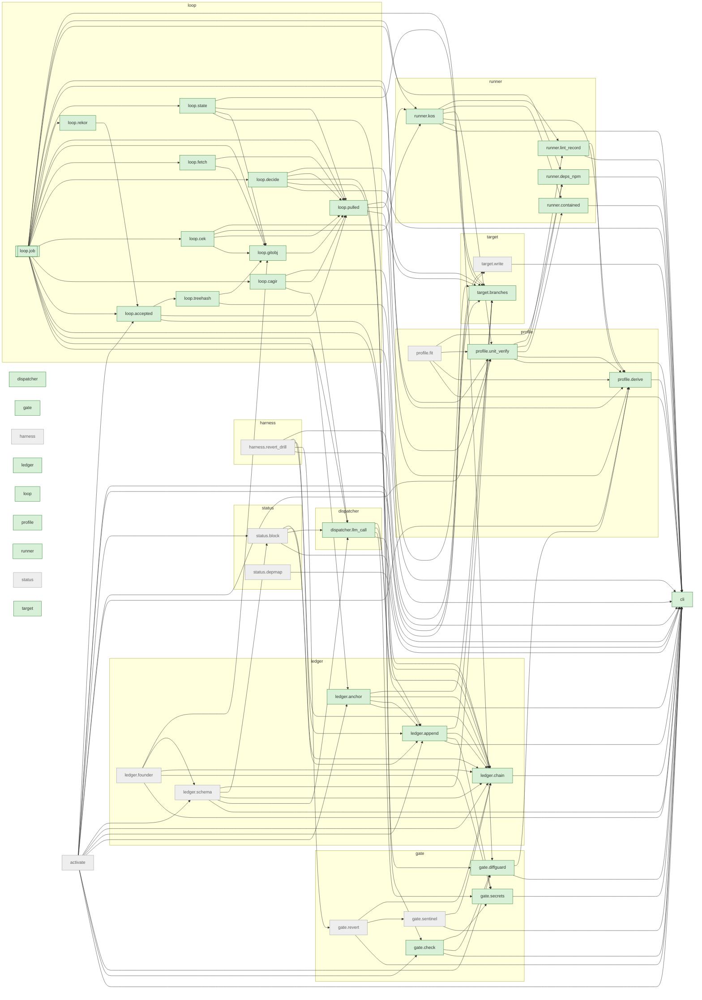

# The brain's dependency map

Generated by `python -m status.depmap brain .` from `referee/`, run there; do not edit by hand.

An arrow A --> B: A holds an import statement naming B. Live roots (double border) are the modules the workflows under `referee/.github/workflows/` start with `python -m`; a live module (green) is reachable from one by imports, which is not proof that it is called; the others (grey) are off the live path: run by tests and vector commands only. Rules and what is not read: `referee/status/depmap.py`.

Modules 45, arrows 124, live roots loop.job, live 33, off the live path 12.

Started by a workflow but not under the root (not drawn): snowball_bootstrap.

Every module off the live path is named, with its reason, in `referee/status/off_live.json` (the last column); a wired module leaves it in the same push. Register problems: none.

| module | file | live | `__main__` | imports | imported by | off the live path because |
|---|---|---|---|---|---|---|
| activate | activate.py | no | yes | cli, gate.check, gate.diffguard, ledger.anchor, ledger.append, ledger.chain, ledger.schema, loop.accepted, profile.derive, profile.unit_verify, status.block, target.branches, target.write |  | unwired: MF18, step (B): the operator's activation of a target; no workflow under referee/.github/workflows starts it yet |
| cli | cli.py | yes |  |  | activate, dispatcher.llm_call, gate.check, gate.diffguard, gate.revert, gate.secrets, gate.sentinel, harness.revert_drill, ledger.anchor, ledger.append, ledger.chain, ledger.founder, ledger.schema, loop.decide, loop.job, loop.treehash, profile.derive, profile.fit, profile.unit_verify, runner.contained, runner.deps_npm, runner.kos, runner.lint_record, status.block, status.depmap, target.write |  |
| dispatcher | dispatcher/__init__.py | yes |  |  |  |  |
| dispatcher.llm_call | dispatcher/llm_call.py | yes | yes | cli, gate.secrets, ledger.append, ledger.chain | ledger.schema, loop.cagir, loop.job, status.block |  |
| gate | gate/__init__.py | yes |  |  |  |  |
| gate.check | gate/check.py | yes | yes | cli, gate.diffguard, gate.secrets | activate, loop.decide |  |
| gate.diffguard | gate/diffguard.py | yes | yes | cli, profile.derive | activate, gate.check, loop.decide, runner.kos |  |
| gate.revert | gate/revert.py | no | yes | cli, gate.sentinel, ledger.chain | harness.revert_drill | unwired: MF13, D7 in job yaz: the cycle's composition inside the jobs is not written (spec-036), so loop.job does not import it |
| gate.secrets | gate/secrets.py | yes | yes | cli | dispatcher.llm_call, gate.check, ledger.append, ledger.founder |  |
| gate.sentinel | gate/sentinel.py | no | yes | cli, ledger.chain | gate.revert | unwired: MF12, D7 in job kos: kos stops after D3 with cycle_not_wired; the cycle's composition inside the jobs is not written (spec-036), so loop.job does not import it |
| harness | harness/__init__.py | no |  |  |  | empty package |
| harness.revert_drill | harness/revert_drill.py | no | yes | cli, gate.revert, ledger.append, ledger.chain, target.write |  | unwired: MF14, D8 in job yaz: the cycle's composition inside the jobs is not written (spec-036), so loop.job does not import it |
| ledger | ledger/__init__.py | yes |  |  |  |  |
| ledger.anchor | ledger/anchor.py | yes | yes | cli, ledger.append, ledger.chain, target.branches | activate, loop.job |  |
| ledger.append | ledger/append.py | yes | yes | cli, gate.secrets, ledger.chain, target.branches | activate, dispatcher.llm_call, harness.revert_drill, ledger.anchor, loop.job, status.block |  |
| ledger.chain | ledger/chain.py | yes | yes | cli | activate, dispatcher.llm_call, gate.revert, gate.sentinel, harness.revert_drill, ledger.anchor, ledger.append, ledger.founder, ledger.schema, loop.accepted, loop.state, status.block |  |
| ledger.founder | ledger/founder.py | no | yes | cli, gate.secrets, ledger.chain, ledger.schema, loop.gitobj |  | session_tool: the founder ledger's rules and its append command, run by a session and by test 14 (tests/test_founder_ledger.py); the loop never writes founder rows |
| ledger.schema | ledger/schema.py | no |  | cli, dispatcher.llm_call, ledger.chain, status.block, target.branches | activate, ledger.founder | unwired: the row shapes the D6 writers produce (test 14); imported by activate only, which is off the live path |
| loop | loop/__init__.py | yes |  |  |  |  |
| loop.accepted | loop/accepted.py | yes |  | ledger.chain, loop.pulled, loop.treehash | activate, loop.job, loop.rekor |  |
| loop.cagir | loop/cagir.py | yes |  | dispatcher.llm_call, loop.pulled, target.branches | loop.job |  |
| loop.cek | loop/cek.py | yes |  | loop.gitobj, loop.pulled, runner.kos, target.branches | loop.job |  |
| loop.decide | loop/decide.py | yes |  | cli, gate.check, gate.diffguard, loop.pulled, profile.unit_verify | loop.job |  |
| loop.fetch | loop/fetch.py | yes |  | loop.gitobj, loop.pulled | loop.job |  |
| loop.gitobj | loop/gitobj.py | yes |  | loop.pulled | ledger.founder, loop.cek, loop.fetch, loop.job, loop.state, loop.treehash |  |
| loop.job | loop/job.py | root | yes | cli, dispatcher.llm_call, ledger.anchor, ledger.append, loop.accepted, loop.cagir, loop.cek, loop.decide, loop.fetch, loop.gitobj, loop.pulled, loop.rekor, loop.state, profile.derive, profile.unit_verify, runner.deps_npm, runner.kos, target.branches |  |  |
| loop.pulled | loop/pulled.py | yes |  | profile.derive, runner.kos, target.branches | loop.accepted, loop.cagir, loop.cek, loop.decide, loop.fetch, loop.gitobj, loop.job, loop.state |  |
| loop.rekor | loop/rekor.py | yes |  | loop.accepted | loop.job |  |
| loop.state | loop/state.py | yes |  | ledger.chain, loop.gitobj, loop.pulled, target.branches | loop.job |  |
| loop.treehash | loop/treehash.py | yes | yes | cli, loop.gitobj | loop.accepted |  |
| profile | profile/__init__.py | yes |  |  |  |  |
| profile.derive | profile/derive.py | yes | yes | cli | activate, gate.diffguard, loop.job, loop.pulled, profile.fit, profile.unit_verify, runner.kos, runner.lint_record |  |
| profile.fit | profile/fit.py | no | yes | cli, profile.derive, profile.unit_verify, runner.deps_npm |  | session_tool: a session composes each unit candidate's recipe from its own npm scripts and judges it with unit_verify.check_recipe; its --units output is targets/<target>/units.json, which loop.cek reads; run by a session and by test 47 (tests/test_profile_fit.py) |
| profile.unit_verify | profile/unit_verify.py | yes | yes | cli, profile.derive, runner.contained, runner.deps_npm, runner.lint_record | activate, loop.decide, loop.job, profile.fit, runner.kos |  |
| runner | runner/__init__.py | yes |  |  |  |  |
| runner.contained | runner/contained.py | yes | yes | cli | profile.unit_verify, runner.kos |  |
| runner.deps_npm | runner/deps_npm.py | yes | yes | cli | loop.job, profile.fit, profile.unit_verify |  |
| runner.kos | runner/kos.py | yes | yes | cli, gate.diffguard, profile.derive, profile.unit_verify, runner.contained, runner.lint_record | loop.cek, loop.job, loop.pulled |  |
| runner.lint_record | runner/lint_record.py | yes | yes | cli, profile.derive | profile.unit_verify, runner.kos |  |
| status | status/__init__.py | no |  |  |  | empty package |
| status.block | status/block.py | no | yes | cli, dispatcher.llm_call, ledger.append, ledger.chain | activate, ledger.schema | unwired: MF16, D6 in job yaz: the cycle's composition inside the jobs is not written (spec-036), so loop.job does not import it |
| status.depmap | status/depmap.py | no | yes | cli |  | session_tool: the dependency drawings, run in a session and by test 42; the loop never runs it |
| target | target/__init__.py | yes |  |  |  |  |
| target.branches | target/branches.py | yes |  |  | activate, ledger.anchor, ledger.append, ledger.schema, loop.cagir, loop.cek, loop.job, loop.pulled, loop.state |  |
| target.write | target/write.py | no | yes | cli | activate, harness.revert_drill | unwired: MF9, D6 in job yaz: the cycle's composition inside the jobs is not written (spec-036), so loop.job does not import it |
