# The brain's dependency map

Generated by `python -m status.depmap brain .` from `referee/`, run there; do not edit by hand.

An arrow A --> B: A holds an import statement naming B. Live roots (double border) are the modules the workflows under `referee/.github/workflows/` start with `python -m`; a live module (green) is reachable from one by imports, which is not proof that it is called; the others (grey) are off the live path: run by tests and vector commands only. Rules and what is not read: `referee/status/depmap.py`.

Modules 88, arrows 299, live roots loop.job, live 75, off the live path 13.

Started by a workflow but not under the root (not drawn): snowball_bootstrap, venv.

Every module off the live path is named, with its reason, in `referee/status/off_live.json` (the last column); a wired module leaves it in the same push. Register problems: none.

```mermaid
flowchart LR
    n0["activate"]
    n1["cases"]
    n3["cli"]
    n4["dispatcher"]
    n6["drift"]
    n8["findings"]
    n10["gate"]
    n16["gozcu"]
    n19["harness"]
    n26["httpbody"]
    n27["ledger"]
    n37["loop"]
    n56["policy"]
    n58["profile"]
    n69["runner"]
    n76["snapshot"]
    n78["status"]
    n83["target"]
  subgraph g_cases["cases"]
    n2["cases.build"]
  end
  subgraph g_dispatcher["dispatcher"]
    n5["dispatcher.llm_call"]
  end
  subgraph g_drift["drift"]
    n7["drift.check"]
  end
  subgraph g_findings["findings"]
    n9["findings.write"]
  end
  subgraph g_gate["gate"]
    n11["gate.check"]
    n12["gate.diffguard"]
    n13["gate.revert"]
    n14["gate.secrets"]
    n15["gate.sentinel"]
  end
  subgraph g_gozcu["gozcu"]
    n17["gozcu.evaluate"]
    n18["gozcu.watch"]
  end
  subgraph g_harness["harness"]
    n20["harness.offline"]
    n21["harness.params"]
    n22["harness.pass_row"]
    n23["harness.revert_drill"]
    n24["harness.score"]
    n25["harness.stats"]
  end
  subgraph g_ledger["ledger"]
    n28["ledger.anchor"]
    n29["ledger.append"]
    n30["ledger.chain"]
    n31["ledger.cost"]
    n32["ledger.cycle"]
    n33["ledger.events"]
    n34["ledger.founder"]
    n35["ledger.schema"]
    n36["ledger.serial"]
  end
  subgraph g_loop["loop"]
    n38["loop.accepted"]
    n39["loop.cagir"]
    n40["loop.cek"]
    n41["loop.decide"]
    n42["loop.drill"]
    n43["loop.fetch"]
    n44["loop.gitobj"]
    n45["loop.inputs"]
    n46["loop.integration"]
    n47[["loop.job"]]
    n48["loop.program"]
    n49["loop.pulled"]
    n50["loop.rekor"]
    n51["loop.sign"]
    n52["loop.state"]
    n53["loop.treehash"]
    n54["loop.watch"]
    n55["loop.write_cycle"]
  end
  subgraph g_policy["policy"]
    n57["policy.reads"]
  end
  subgraph g_profile["profile"]
    n59["profile.derive"]
    n60["profile.docker"]
    n61["profile.fit"]
    n62["profile.ghactions"]
    n63["profile.jsimports"]
    n64["profile.kustomize"]
    n65["profile.nx"]
    n66["profile.pypath"]
    n67["profile.unit_verify"]
    n68["profile.yamlblock"]
  end
  subgraph g_runner["runner"]
    n70["runner.contained"]
    n71["runner.deps_npm"]
    n72["runner.kos"]
    n73["runner.lint_record"]
    n74["runner.organs"]
    n75["runner.test_results"]
  end
  subgraph g_snapshot["snapshot"]
    n77["snapshot.make"]
  end
  subgraph g_status["status"]
    n79["status.block"]
    n80["status.depmap"]
    n81["status.exit_b"]
    n82["status.pygraph"]
  end
  subgraph g_target["target"]
    n84["target.app_jwt"]
    n85["target.branches"]
    n86["target.land"]
    n87["target.write"]
  end
  n0 --> n3
  n0 --> n7
  n0 --> n11
  n0 --> n29
  n0 --> n30
  n0 --> n32
  n0 --> n33
  n0 --> n35
  n0 --> n38
  n0 --> n49
  n0 --> n55
  n0 --> n85
  n0 --> n86
  n0 --> n87
  n2 --> n11
  n2 --> n12
  n5 --> n3
  n5 --> n14
  n5 --> n29
  n5 --> n30
  n5 --> n31
  n5 --> n57
  n7 --> n3
  n7 --> n30
  n7 --> n35
  n7 --> n85
  n7 --> n87
  n9 --> n2
  n9 --> n29
  n9 --> n30
  n9 --> n33
  n9 --> n35
  n9 --> n59
  n11 --> n3
  n11 --> n12
  n11 --> n14
  n12 --> n3
  n12 --> n59
  n13 --> n3
  n13 --> n15
  n13 --> n30
  n14 --> n3
  n15 --> n3
  n15 --> n30
  n17 --> n21
  n17 --> n35
  n17 --> n57
  n18 --> n17
  n18 --> n31
  n18 --> n33
  n18 --> n35
  n18 --> n36
  n20 --> n3
  n20 --> n82
  n21 --> n57
  n22 --> n3
  n22 --> n23
  n22 --> n28
  n22 --> n30
  n22 --> n35
  n22 --> n36
  n22 --> n38
  n22 --> n42
  n22 --> n85
  n23 --> n3
  n23 --> n13
  n23 --> n29
  n23 --> n30
  n23 --> n86
  n23 --> n87
  n24 --> n2
  n24 --> n3
  n24 --> n25
  n24 --> n59
  n24 --> n77
  n25 --> n3
  n28 --> n3
  n28 --> n29
  n28 --> n30
  n28 --> n85
  n29 --> n3
  n29 --> n14
  n29 --> n30
  n29 --> n85
  n30 --> n3
  n31 --> n30
  n32 --> n28
  n32 --> n29
  n32 --> n30
  n32 --> n35
  n32 --> n79
  n33 --> n12
  n34 --> n3
  n34 --> n14
  n34 --> n30
  n34 --> n35
  n34 --> n44
  n35 --> n3
  n35 --> n30
  n35 --> n31
  n35 --> n79
  n35 --> n85
  n36 --> n30
  n36 --> n35
  n38 --> n3
  n38 --> n26
  n38 --> n30
  n38 --> n44
  n38 --> n48
  n38 --> n49
  n38 --> n53
  n39 --> n3
  n39 --> n5
  n39 --> n49
  n39 --> n57
  n39 --> n59
  n39 --> n85
  n40 --> n2
  n40 --> n3
  n40 --> n21
  n40 --> n44
  n40 --> n49
  n40 --> n59
  n40 --> n72
  n40 --> n74
  n40 --> n77
  n40 --> n85
  n41 --> n3
  n41 --> n11
  n41 --> n12
  n41 --> n49
  n41 --> n67
  n42 --> n3
  n42 --> n20
  n42 --> n23
  n42 --> n30
  n42 --> n38
  n42 --> n86
  n43 --> n44
  n43 --> n49
  n44 --> n49
  n45 --> n3
  n45 --> n30
  n45 --> n38
  n46 --> n36
  n46 --> n44
  n46 --> n49
  n47 --> n0
  n47 --> n2
  n47 --> n3
  n47 --> n5
  n47 --> n7
  n47 --> n13
  n47 --> n18
  n47 --> n20
  n47 --> n21
  n47 --> n22
  n47 --> n24
  n47 --> n28
  n47 --> n29
  n47 --> n35
  n47 --> n36
  n47 --> n38
  n47 --> n39
  n47 --> n40
  n47 --> n41
  n47 --> n42
  n47 --> n43
  n47 --> n44
  n47 --> n45
  n47 --> n46
  n47 --> n48
  n47 --> n49
  n47 --> n50
  n47 --> n51
  n47 --> n52
  n47 --> n54
  n47 --> n55
  n47 --> n59
  n47 --> n67
  n47 --> n71
  n47 --> n72
  n47 --> n77
  n47 --> n84
  n47 --> n85
  n47 --> n86
  n47 --> n87
  n49 --> n3
  n49 --> n59
  n49 --> n72
  n49 --> n85
  n50 --> n3
  n50 --> n26
  n50 --> n38
  n50 --> n48
  n51 --> n3
  n51 --> n28
  n51 --> n38
  n51 --> n48
  n51 --> n50
  n52 --> n30
  n52 --> n44
  n52 --> n49
  n52 --> n85
  n53 --> n3
  n53 --> n44
  n54 --> n3
  n54 --> n11
  n54 --> n15
  n54 --> n36
  n54 --> n72
  n54 --> n73
  n55 --> n3
  n55 --> n5
  n55 --> n13
  n55 --> n15
  n55 --> n17
  n55 --> n18
  n55 --> n21
  n55 --> n22
  n55 --> n23
  n55 --> n29
  n55 --> n31
  n55 --> n32
  n55 --> n33
  n55 --> n35
  n55 --> n36
  n55 --> n39
  n55 --> n49
  n55 --> n85
  n55 --> n86
  n55 --> n87
  n57 --> n3
  n57 --> n30
  n59 --> n3
  n59 --> n57
  n60 --> n3
  n61 --> n3
  n61 --> n59
  n61 --> n63
  n61 --> n65
  n61 --> n67
  n61 --> n71
  n62 --> n3
  n63 --> n3
  n65 --> n59
  n65 --> n70
  n67 --> n3
  n67 --> n57
  n67 --> n59
  n67 --> n70
  n67 --> n71
  n67 --> n73
  n70 --> n3
  n71 --> n3
  n71 --> n26
  n71 --> n57
  n72 --> n3
  n72 --> n12
  n72 --> n15
  n72 --> n59
  n72 --> n67
  n72 --> n70
  n72 --> n73
  n72 --> n74
  n72 --> n75
  n73 --> n3
  n73 --> n59
  n74 --> n59
  n74 --> n70
  n75 --> n73
  n77 --> n44
  n77 --> n59
  n77 --> n85
  n79 --> n3
  n79 --> n29
  n79 --> n30
  n79 --> n31
  n79 --> n85
  n80 --> n3
  n80 --> n60
  n80 --> n62
  n80 --> n63
  n80 --> n64
  n80 --> n66
  n80 --> n68
  n80 --> n82
  n81 --> n3
  n81 --> n22
  n81 --> n34
  n86 --> n12
  n86 --> n13
  n86 --> n29
  n86 --> n59
  n86 --> n85
  n86 --> n87
  n87 --> n3
  n87 --> n14
  n87 --> n26
  classDef live fill:#d8f0d8,stroke:#2e7d32
  classDef off fill:#eeeeee,stroke:#9e9e9e,color:#616161
  class n0,n1,n2,n3,n4,n5,n6,n7,n10,n11,n12,n13,n14,n15,n16,n17,n18,n19,n20,n21,n22,n23,n24,n25,n26,n27,n28,n29,n30,n31,n32,n33,n35,n36,n37,n38,n39,n40,n41,n42,n43,n44,n45,n46,n47,n48,n49,n50,n51,n52,n53,n54,n55,n56,n57,n58,n59,n67,n69,n70,n71,n72,n73,n74,n75,n76,n77,n78,n79,n82,n83,n84,n85,n86,n87 live
  class n8,n9,n34,n60,n61,n62,n63,n64,n65,n66,n68,n80,n81 off
```

| module | file | live | `__main__` | imports | imported by | off the live path because |
|---|---|---|---|---|---|---|
| activate | activate.py | yes | yes | cli, drift.check, gate.check, ledger.append, ledger.chain, ledger.cycle, ledger.events, ledger.schema, loop.accepted, loop.pulled, loop.write_cycle, target.branches, target.land, target.write | loop.job |  |
| cases | cases/__init__.py | yes |  |  |  |  |
| cases.build | cases/build.py | yes |  | gate.check, gate.diffguard | findings.write, harness.score, loop.cek, loop.job |  |
| cli | cli.py | yes |  |  | activate, dispatcher.llm_call, drift.check, gate.check, gate.diffguard, gate.revert, gate.secrets, gate.sentinel, harness.offline, harness.pass_row, harness.revert_drill, harness.score, harness.stats, ledger.anchor, ledger.append, ledger.chain, ledger.founder, ledger.schema, loop.accepted, loop.cagir, loop.cek, loop.decide, loop.drill, loop.inputs, loop.job, loop.pulled, loop.rekor, loop.sign, loop.treehash, loop.watch, loop.write_cycle, policy.reads, profile.derive, profile.docker, profile.fit, profile.ghactions, profile.jsimports, profile.unit_verify, runner.contained, runner.deps_npm, runner.kos, runner.lint_record, status.block, status.depmap, status.exit_b, target.write |  |
| dispatcher | dispatcher/__init__.py | yes |  |  |  |  |
| dispatcher.llm_call | dispatcher/llm_call.py | yes | yes | cli, gate.secrets, ledger.append, ledger.chain, ledger.cost, policy.reads | loop.cagir, loop.job, loop.write_cycle |  |
| drift | drift/__init__.py | yes |  |  |  |  |
| drift.check | drift/check.py | yes | yes | cli, ledger.chain, ledger.schema, target.branches, target.write | activate, loop.job |  |
| findings | findings/__init__.py | no |  |  |  | empty package |
| findings.write | findings/write.py | no |  | cases.build, ledger.append, ledger.chain, ledger.events, ledger.schema, profile.derive |  | unwired: the finding registry's rows of tohum/26h MF8 (fingerprint, proposal to finding rows, gate decisions to fixed and unresolved rows) as functions over the two files' bytes, run by test 12 (tests/test_findings_write.py) only; no job hands it an adapter proposal, and the write to brain/state with the root over both files is not built (seed-086), so MF8 is not in done_mf |
| gate | gate/__init__.py | yes |  |  |  |  |
| gate.check | gate/check.py | yes | yes | cli, gate.diffguard, gate.secrets | activate, cases.build, loop.decide, loop.watch |  |
| gate.diffguard | gate/diffguard.py | yes | yes | cli, profile.derive | cases.build, gate.check, ledger.events, loop.decide, runner.kos, target.land |  |
| gate.revert | gate/revert.py | yes | yes | cli, gate.sentinel, ledger.chain | harness.revert_drill, loop.job, loop.write_cycle, target.land |  |
| gate.secrets | gate/secrets.py | yes | yes | cli | dispatcher.llm_call, gate.check, ledger.append, ledger.founder, target.write |  |
| gate.sentinel | gate/sentinel.py | yes | yes | cli, ledger.chain | gate.revert, loop.watch, loop.write_cycle, runner.kos |  |
| gozcu | gozcu/__init__.py | yes |  |  |  |  |
| gozcu.evaluate | gozcu/evaluate.py | yes |  | harness.params, ledger.schema, policy.reads | gozcu.watch, loop.write_cycle |  |
| gozcu.watch | gozcu/watch.py | yes |  | gozcu.evaluate, ledger.cost, ledger.events, ledger.schema, ledger.serial | loop.job, loop.write_cycle |  |
| harness | harness/__init__.py | yes |  |  |  |  |
| harness.offline | harness/offline.py | yes | yes | cli, status.pygraph | loop.drill, loop.job |  |
| harness.params | harness/params.py | yes |  | policy.reads | gozcu.evaluate, loop.cek, loop.job, loop.write_cycle |  |
| harness.pass_row | harness/pass_row.py | yes | yes | cli, harness.revert_drill, ledger.anchor, ledger.chain, ledger.schema, ledger.serial, loop.accepted, loop.drill, target.branches | loop.job, loop.write_cycle, status.exit_b |  |
| harness.revert_drill | harness/revert_drill.py | yes | yes | cli, gate.revert, ledger.append, ledger.chain, target.land, target.write | harness.pass_row, loop.drill, loop.write_cycle |  |
| harness.score | harness/score.py | yes | yes | cases.build, cli, harness.stats, profile.derive, snapshot.make | loop.job |  |
| harness.stats | harness/stats.py | yes | yes | cli | harness.score |  |
| httpbody | httpbody.py | yes |  |  | loop.accepted, loop.rekor, runner.deps_npm, target.write |  |
| ledger | ledger/__init__.py | yes |  |  |  |  |
| ledger.anchor | ledger/anchor.py | yes | yes | cli, ledger.append, ledger.chain, target.branches | harness.pass_row, ledger.cycle, loop.job, loop.sign |  |
| ledger.append | ledger/append.py | yes | yes | cli, gate.secrets, ledger.chain, target.branches | activate, dispatcher.llm_call, findings.write, harness.revert_drill, ledger.anchor, ledger.cycle, loop.job, loop.write_cycle, status.block, target.land |  |
| ledger.chain | ledger/chain.py | yes | yes | cli | activate, dispatcher.llm_call, drift.check, findings.write, gate.revert, gate.sentinel, harness.pass_row, harness.revert_drill, ledger.anchor, ledger.append, ledger.cost, ledger.cycle, ledger.founder, ledger.schema, ledger.serial, loop.accepted, loop.drill, loop.inputs, loop.state, policy.reads, status.block |  |
| ledger.cost | ledger/cost.py | yes |  | ledger.chain | dispatcher.llm_call, gozcu.watch, ledger.schema, loop.write_cycle, status.block |  |
| ledger.cycle | ledger/cycle.py | yes |  | ledger.anchor, ledger.append, ledger.chain, ledger.schema, status.block | activate, loop.write_cycle |  |
| ledger.events | ledger/events.py | yes |  | gate.diffguard | activate, findings.write, gozcu.watch, loop.write_cycle |  |
| ledger.founder | ledger/founder.py | no | yes | cli, gate.secrets, ledger.chain, ledger.schema, loop.gitobj | status.exit_b | session_tool: the founder ledger's rules and its append command, run by a session and by test 14 (tests/test_founder_ledger.py); the loop never writes founder rows |
| ledger.schema | ledger/schema.py | yes |  | cli, ledger.chain, ledger.cost, status.block, target.branches | activate, drift.check, findings.write, gozcu.evaluate, gozcu.watch, harness.pass_row, ledger.cycle, ledger.founder, ledger.serial, loop.job, loop.write_cycle |  |
| ledger.serial | ledger/serial.py | yes |  | ledger.chain, ledger.schema | gozcu.watch, harness.pass_row, loop.integration, loop.job, loop.watch, loop.write_cycle |  |
| loop | loop/__init__.py | yes |  |  |  |  |
| loop.accepted | loop/accepted.py | yes |  | cli, httpbody, ledger.chain, loop.gitobj, loop.program, loop.pulled, loop.treehash | activate, harness.pass_row, loop.drill, loop.inputs, loop.job, loop.rekor, loop.sign |  |
| loop.cagir | loop/cagir.py | yes |  | cli, dispatcher.llm_call, loop.pulled, policy.reads, profile.derive, target.branches | loop.job, loop.write_cycle |  |
| loop.cek | loop/cek.py | yes |  | cases.build, cli, harness.params, loop.gitobj, loop.pulled, profile.derive, runner.kos, runner.organs, snapshot.make, target.branches | loop.job |  |
| loop.decide | loop/decide.py | yes |  | cli, gate.check, gate.diffguard, loop.pulled, profile.unit_verify | loop.job |  |
| loop.drill | loop/drill.py | yes |  | cli, harness.offline, harness.revert_drill, ledger.chain, loop.accepted, target.land | harness.pass_row, loop.job |  |
| loop.fetch | loop/fetch.py | yes |  | loop.gitobj, loop.pulled | loop.job |  |
| loop.gitobj | loop/gitobj.py | yes |  | loop.pulled | ledger.founder, loop.accepted, loop.cek, loop.fetch, loop.integration, loop.job, loop.state, loop.treehash, snapshot.make |  |
| loop.inputs | loop/inputs.py | yes |  | cli, ledger.chain, loop.accepted | loop.job |  |
| loop.integration | loop/integration.py | yes |  | ledger.serial, loop.gitobj, loop.pulled | loop.job |  |
| loop.job | loop/job.py | root | yes | activate, cases.build, cli, dispatcher.llm_call, drift.check, gate.revert, gozcu.watch, harness.offline, harness.params, harness.pass_row, harness.score, ledger.anchor, ledger.append, ledger.schema, ledger.serial, loop.accepted, loop.cagir, loop.cek, loop.decide, loop.drill, loop.fetch, loop.gitobj, loop.inputs, loop.integration, loop.program, loop.pulled, loop.rekor, loop.sign, loop.state, loop.watch, loop.write_cycle, profile.derive, profile.unit_verify, runner.deps_npm, runner.kos, snapshot.make, target.app_jwt, target.branches, target.land, target.write |  |  |
| loop.program | loop/program.py | yes |  |  | loop.accepted, loop.job, loop.rekor, loop.sign |  |
| loop.pulled | loop/pulled.py | yes |  | cli, profile.derive, runner.kos, target.branches | activate, loop.accepted, loop.cagir, loop.cek, loop.decide, loop.fetch, loop.gitobj, loop.integration, loop.job, loop.state, loop.write_cycle |  |
| loop.rekor | loop/rekor.py | yes |  | cli, httpbody, loop.accepted, loop.program | loop.job, loop.sign |  |
| loop.sign | loop/sign.py | yes |  | cli, ledger.anchor, loop.accepted, loop.program, loop.rekor | loop.job |  |
| loop.state | loop/state.py | yes |  | ledger.chain, loop.gitobj, loop.pulled, target.branches | loop.job |  |
| loop.treehash | loop/treehash.py | yes | yes | cli, loop.gitobj | loop.accepted |  |
| loop.watch | loop/watch.py | yes |  | cli, gate.check, gate.sentinel, ledger.serial, runner.kos, runner.lint_record | loop.job |  |
| loop.write_cycle | loop/write_cycle.py | yes |  | cli, dispatcher.llm_call, gate.revert, gate.sentinel, gozcu.evaluate, gozcu.watch, harness.params, harness.pass_row, harness.revert_drill, ledger.append, ledger.cost, ledger.cycle, ledger.events, ledger.schema, ledger.serial, loop.cagir, loop.pulled, target.branches, target.land, target.write | activate, loop.job |  |
| policy | policy/__init__.py | yes |  |  |  |  |
| policy.reads | policy/reads.py | yes | yes | cli, ledger.chain | dispatcher.llm_call, gozcu.evaluate, harness.params, loop.cagir, profile.derive, profile.unit_verify, runner.deps_npm |  |
| profile | profile/__init__.py | yes |  |  |  |  |
| profile.derive | profile/derive.py | yes | yes | cli, policy.reads | findings.write, gate.diffguard, harness.score, loop.cagir, loop.cek, loop.job, loop.pulled, profile.fit, profile.nx, profile.unit_verify, runner.kos, runner.lint_record, runner.organs, snapshot.make, target.land |  |
| profile.docker | profile/docker.py | no |  | cli | status.depmap | session_tool: what a Dockerfile copies from its build context and the build contexts compose files name, read by status.depmap (a session tool) only; run by tests 42 and 47 (tests/test_depmap.py, tests/test_profile_docker.py) |
| profile.fit | profile/fit.py | no | yes | cli, profile.derive, profile.jsimports, profile.nx, profile.unit_verify, runner.deps_npm |  | session_tool: a session composes each unit candidate's recipe from its own npm scripts and judges it with unit_verify.check_recipe; its --units output is targets/<target>/units.json, which loop.cek reads; run by a session and by test 47 (tests/test_profile_fit.py) |
| profile.ghactions | profile/ghactions.py | no |  | cli | status.depmap | session_tool: the image builds (context, Dockerfile) GitHub Actions steps of docker/build-push-action declare, matrices and expressions over matrix evaluated statically, read by status.depmap (a session tool) only; run by tests 42 and 47 (tests/test_depmap.py, tests/test_profile_ghactions.py) |
| profile.jsimports | profile/jsimports.py | no |  | cli | profile.fit, status.depmap | session_tool: the one reader of a JS/TS tree's references (walk, import specifiers, tsconfig extends and path aliases, a bare specifier's package), read by status.depmap and profile.fit (session tools) only; run by tests 42 and 47 (tests/test_depmap.py, tests/test_profile_jsimports.py, tests/test_profile_fit.py) |
| profile.kustomize | profile/kustomize.py | no |  |  | status.depmap | session_tool: the paths a Kustomize kustomization file names (resources, components, patches, generators' files), read by status.depmap (a session tool) only; run by tests 42 and 47 (tests/test_depmap.py, tests/test_profile_kustomize.py) |
| profile.nx | profile/nx.py | no |  | profile.derive, runner.contained | profile.fit | session_tool: an Nx project's lint and test targets as the commands their executors run, read by profile.fit (a session tool) only; run by a session and by test 47 (tests/test_profile_nx.py) |
| profile.pypath | profile/pypath.py | no |  |  | status.depmap | session_tool: the directories a Python file puts on sys.path, read statically, read by status.depmap (a session tool) only; run by tests 42 and 47 (tests/test_depmap.py, tests/test_profile_pypath.py) |
| profile.unit_verify | profile/unit_verify.py | yes | yes | cli, policy.reads, profile.derive, runner.contained, runner.deps_npm, runner.lint_record | loop.decide, loop.job, profile.fit, runner.kos |  |
| profile.yamlblock | profile/yamlblock.py | no |  |  | status.depmap | session_tool: a reader of the YAML of CI and container files (block and flow collections, scalars, anchors and merge keys), used by profile.ghactions for status.depmap (a session tool) only; run by tests 42 and 47 (tests/test_depmap.py, tests/test_profile_yamlblock.py) |
| runner | runner/__init__.py | yes |  |  |  |  |
| runner.contained | runner/contained.py | yes | yes | cli | profile.nx, profile.unit_verify, runner.kos, runner.organs |  |
| runner.deps_npm | runner/deps_npm.py | yes | yes | cli, httpbody, policy.reads | loop.job, profile.fit, profile.unit_verify |  |
| runner.kos | runner/kos.py | yes | yes | cli, gate.diffguard, gate.sentinel, profile.derive, profile.unit_verify, runner.contained, runner.lint_record, runner.organs, runner.test_results | loop.cek, loop.job, loop.pulled, loop.watch |  |
| runner.lint_record | runner/lint_record.py | yes | yes | cli, profile.derive | loop.watch, profile.unit_verify, runner.kos, runner.test_results |  |
| runner.organs | runner/organs.py | yes |  | profile.derive, runner.contained | loop.cek, runner.kos |  |
| runner.test_results | runner/test_results.py | yes |  | runner.lint_record | runner.kos |  |
| snapshot | snapshot/__init__.py | yes |  |  |  |  |
| snapshot.make | snapshot/make.py | yes |  | loop.gitobj, profile.derive, target.branches | harness.score, loop.cek, loop.job |  |
| status | status/__init__.py | yes |  |  |  |  |
| status.block | status/block.py | yes | yes | cli, ledger.append, ledger.chain, ledger.cost, target.branches | ledger.cycle, ledger.schema |  |
| status.depmap | status/depmap.py | no | yes | cli, profile.docker, profile.ghactions, profile.jsimports, profile.kustomize, profile.pypath, profile.yamlblock, status.pygraph |  | session_tool: the dependency drawings, run in a session and by test 42; the loop never runs it |
| status.exit_b | status/exit_b.py | no | yes | cli, harness.pass_row, ledger.founder |  | session_tool: the exit audit of asama-0/10a against harness.pass_row and the generated docs/exit-b.md, run by a session (python tests/test_rehearsal.py --doc) and by test 45 (tests/test_exit_b.py, tests/test_rehearsal.py); the loop never runs it |
| status.pygraph | status/pygraph.py | yes |  |  | harness.offline, status.depmap |  |
| target | target/__init__.py | yes |  |  |  |  |
| target.app_jwt | target/app_jwt.py | yes |  |  | loop.job |  |
| target.branches | target/branches.py | yes |  |  | activate, drift.check, harness.pass_row, ledger.anchor, ledger.append, ledger.schema, loop.cagir, loop.cek, loop.job, loop.pulled, loop.state, loop.write_cycle, snapshot.make, status.block, target.land |  |
| target.land | target/land.py | yes |  | gate.diffguard, gate.revert, ledger.append, profile.derive, target.branches, target.write | activate, harness.revert_drill, loop.drill, loop.job, loop.write_cycle |  |
| target.write | target/write.py | yes | yes | cli, gate.secrets, httpbody | activate, drift.check, harness.revert_drill, loop.job, loop.write_cycle, target.land |  |
