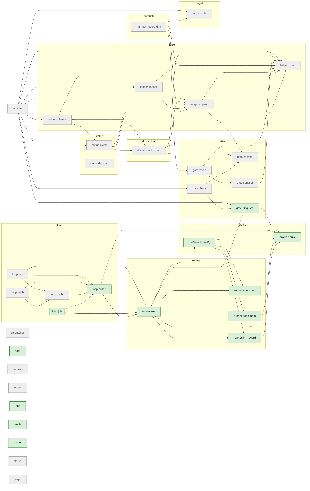

# The brain's dependency map

Generated by `python -m status.depmap brain .` from `referee/`, run there; do not edit by hand.

An arrow A --> B: A holds an import statement naming B. Live roots (double border) are the modules the workflows under `referee/.github/workflows/` start with `python -m`; a live module (green) is reachable from one by imports, which is not proof that it is called; the others (grey) are off the live path: run by tests and vector commands only. Rules and what is not read: `referee/status/depmap.py`.

Modules 35, arrows 51, live roots loop.job, live 13, off the live path 22.

Started by a workflow but not under the root (not drawn): snowball_bootstrap.

| module | file | live | `__main__` | imports | imported by |
|---|---|---|---|---|---|
| activate | activate.py | no | yes | gate.check, gate.diffguard, ledger.anchor, ledger.append, ledger.chain, ledger.schema, status.block, target.write |  |
| dispatcher | dispatcher/__init__.py | no |  |  |  |
| dispatcher.llm_call | dispatcher/llm_call.py | no | yes | gate.secrets, ledger.append, ledger.chain | ledger.schema, status.block |
| gate | gate/__init__.py | yes |  |  |  |
| gate.check | gate/check.py | no | yes | gate.diffguard, gate.secrets | activate |
| gate.diffguard | gate/diffguard.py | yes | yes | profile.derive | activate, gate.check, runner.kos |
| gate.revert | gate/revert.py | no | yes | gate.sentinel, ledger.chain | harness.revert_drill |
| gate.secrets | gate/secrets.py | no | yes |  | dispatcher.llm_call, gate.check, ledger.append |
| gate.sentinel | gate/sentinel.py | no | yes | ledger.chain | gate.revert |
| harness | harness/__init__.py | no |  |  |  |
| harness.revert_drill | harness/revert_drill.py | no | yes | gate.revert, ledger.append, ledger.chain, target.write |  |
| ledger | ledger/__init__.py | no |  |  |  |
| ledger.anchor | ledger/anchor.py | no | yes | ledger.append, ledger.chain | activate |
| ledger.append | ledger/append.py | no | yes | gate.secrets, ledger.chain | activate, dispatcher.llm_call, harness.revert_drill, ledger.anchor, status.block |
| ledger.chain | ledger/chain.py | no | yes |  | activate, dispatcher.llm_call, gate.revert, gate.sentinel, harness.revert_drill, ledger.anchor, ledger.append, ledger.schema, status.block |
| ledger.schema | ledger/schema.py | no |  | dispatcher.llm_call, ledger.chain, status.block | activate |
| loop | loop/__init__.py | yes |  |  |  |
| loop.cek | loop/cek.py | no |  | loop.gitobj, loop.pulled, runner.kos |  |
| loop.fetch | loop/fetch.py | no |  | loop.gitobj, loop.pulled |  |
| loop.gitobj | loop/gitobj.py | no |  | loop.pulled | loop.cek, loop.fetch |
| loop.job | loop/job.py | root | yes | loop.pulled, runner.kos |  |
| loop.pulled | loop/pulled.py | yes |  | profile.derive, runner.kos | loop.cek, loop.fetch, loop.gitobj, loop.job |
| profile | profile/__init__.py | yes |  |  |  |
| profile.derive | profile/derive.py | yes | yes |  | gate.diffguard, loop.pulled, profile.unit_verify, runner.kos, runner.lint_record |
| profile.unit_verify | profile/unit_verify.py | yes | yes | profile.derive, runner.contained, runner.deps_npm, runner.lint_record | runner.kos |
| runner | runner/__init__.py | yes |  |  |  |
| runner.contained | runner/contained.py | yes | yes |  | profile.unit_verify, runner.kos |
| runner.deps_npm | runner/deps_npm.py | yes | yes |  | profile.unit_verify |
| runner.kos | runner/kos.py | yes | yes | gate.diffguard, profile.derive, profile.unit_verify, runner.contained, runner.lint_record | loop.cek, loop.job, loop.pulled |
| runner.lint_record | runner/lint_record.py | yes | yes | profile.derive | profile.unit_verify, runner.kos |
| status | status/__init__.py | no |  |  |  |
| status.block | status/block.py | no | yes | dispatcher.llm_call, ledger.append, ledger.chain | activate, ledger.schema |
| status.depmap | status/depmap.py | no | yes |  |  |
| target | target/__init__.py | no |  |  |  |
| target.write | target/write.py | no | yes |  | activate, harness.revert_drill |
