# The target's dependency map

Generated by `python -m status.depmap target ROOT --source ...` from the target checkout at commit 4f479013a42f4b750e0784cc2500bd17d932af1a, read only; do not edit by hand.

A box is a project (a directory named by the root's npm workspaces, an Nx `project.json`, a Cargo package's `Cargo.toml` or a `pyproject.toml`; of kind `tsconfig`: a directory holding a TypeScript configuration that no such project holds; or of kind `path`: a directory a Python file puts on `sys.path` that no such project holds, or a package directory a Python file imports through one it puts there, found only at the root); an arrow A --> B is labelled with how it was found: `npm` or `cargo` (A's manifest names B, for Cargo also through its workspace or a `[patch]`), `import` (a JS/TS file of A imports into B), `python` (a Python file of A imports a package of B), `sys.path` (a Python file of A imports a name found in a directory the same file puts on `sys.path`, and B holds it). Rules and what is not read: `referee/status/depmap.py` and `referee/profile/pypath.py`.

Projects 88 (npm 24, nx 59, cargo 17, python 1, tsconfig 14, path 3), arrows 253. Files 15201; JS/TS files read 9340 (25 outside any project), Python files read 1629 (0 outside any project, 0 not parsed). Imports: 7075 across projects, 30650 inside one, 16371 of external JS packages, 11150 of Python modules no project holds, 3726 relative Python (not drawn), 19 from or into no project, 0 leaving the root.

`sys.path` insertions in Python files: 231 calls; 244 directories resolved (0 not in the checkout), 0 leaving the root, 5 calls or values not resolved (4 files: aria-kernel/aria_kernel/_validation_unittest_child.py, aria-kernel/tests/test_daily_report_anchor_invariant.py, aria-kernel/tests/test_judgment_funnel.py, ...); 1217 imports resolved through them.

Code files whose references are not read (`OTHER_CODE_EXTENSIONS` by extension, `CODE_FILE_NAMES` by name: other languages, shell, Terraform, Dockerfiles, Makefiles, SQL, GraphQL, protobuf, jq): .graphql 2 (0 in no project), .h 1 (0 in no project), .hcl 1 (1 in no project), .jq 1 (1 in no project), .ps1 1 (0 in no project), .rs 447 (0 in no project), .sh 81 (21 in no project), .sql 52 (28 in no project), .tf 56 (55 in no project), Dockerfile 3 (1 in no project), Dockerfile.* 15 (13 in no project).

Dependency manifests found and not read (`MANIFESTS_NOT_READ`; `package.json` outside the npm workspaces): package.json 7 (e2e/package.json, infrastructure/simulators/nodered/data/package.json, scripts/nats/package.json, ...).

Files of no stated kind (an extension in none of the lists, nor in `NOT_CODE_EXTENSIONS`): .archived-2026-05-18 4 (infrastructure/docker/init-scripts/.archive/00-init-schemas.sh.archived-2026-05-18, infrastructure/docker/init-scripts/.archive/05-platform-functions.sql.archived-2026-05-18, infrastructure/docker/init-scripts/.archive/09-hr-outbox.sql.archived-2026-05-18, ...); .backup 2 (infrastructure/simulators/nodered/data/.config.runtime.json.backup, infrastructure/simulators/nodered/data/.config.users.json.backup); .bundle 1 (aria-kernel/tests/fixtures/runtime_archive_legacy/source.bundle); .diff 1 (tests/invariants/fixtures/plan-020/diff-with-ts-ignore.diff); .example 6 (.env.example, .env.production.example, apps/messaging-service/.env.example, ...); .gitconfig 1 (aria-kernel/tests/_helpers/hermetic.gitconfig); .service 7 (infrastructure/aria/aria-gateway.service, infrastructure/aria/aria-telemetry.service, infrastructure/dataflow-probe/aqua-dataflow-probe@.service, ...); .socket 1 (infrastructure/dataflow-probe/aqua-dataflow-probe.socket); .stderr 4 (crates/nats-client/tests/auth_surface_compile_fail/no_token.stderr, crates/nats-client/tests/auth_surface_compile_fail/no_unauthenticated.stderr, crates/nats-client/tests/auth_surface_compile_fail/no_user_pass.stderr, ...); .template 4 (aria-config/genesis_policy.json.template, deploy/production/secret.yaml.template, deploy/staging/secret.yaml.template, ...); .timer 3 (infrastructure/aria/aria-telemetry.timer, infrastructure/supervisor/aqua-supervisor.timer, scripts/aria/runner-habitat/systemd/aria-t2-probe.timer); .tpl 2 (infra/helm/charts/aquaculture-platform/templates/_helpers.tpl, infrastructure/helm/aquaculture/templates/_helpers.tpl); .utf8 11 (aria-kernel/tests/fixtures/prompt_render_issued_v4/issued-v4-map-missing-history.fused.prompt.utf8, aria-kernel/tests/fixtures/prompt_render_issued_v4/issued-v4-map-missing-history.prompt.utf8, aria-kernel/tests/fixtures/prompt_render_issued_v4/issued-v4-map-rejected-history.fused.prompt.utf8, ...); .vars 1 (infrastructure/deploy/service-catalog.deploy.vars); .webmanifest 1 (web/apps/aquamobil/public/manifest.webmanifest); files with no extension and no `CODE_FILE_NAMES` name: 48 (.codex, .dockerignore, .gitattributes, ...).

```mermaid
flowchart LR
  subgraph g0["apps"]
    n0["admin-api-service"]
    n1["ai-service"]
    n2["alert-engine"]
    n3["auth-service"]
    n4["billing-service"]
    n5["config-service"]
    n6["db-migrate"]
    n7["event-store-service"]
    n8["farm-service"]
    n9["gateway-api"]
    n10["hr-service"]
    n11["hydroponics-service"]
    n12["messaging-service"]
    n13["notification-service"]
    n14["observability-service"]
    n15["sensor-ingestion"]
    n16["sensor-service"]
  end
  subgraph g1["aria-kernel"]
    n17["aria-kernel"]
  end
  subgraph g2["crates"]
    n18["alarm-core"]
    n19["alarm-core-wasm"]
    n20["event-contracts-rs"]
    n21["rumqttc"]
    n22["nats-client"]
    n23["observability"]
    n24["outbox-rs"]
    n25["protocol-codec-rs"]
    n26["protocol-codec-wasm"]
    n27["protocol-codec-fuzz"]
    n28["router-coprocessor"]
    n29["tenant-context"]
  end
  subgraph g3["e2e"]
    n30["@aquaculture/e2e-tests"]
  end
  subgraph g4["infrastructure"]
    n31["node-red-project"]
  end
  subgraph g5["libs"]
    n32["@platform/alarm-core"]
    n33["@platform/aquaculture-engines"]
    n34["backend-common"]
    n35["event-contracts"]
    n36["@aquaculture/farm-shared"]
    n37["@platform/migration-harness"]
    n38["@platform/mqtt-test-harness"]
    n39["@aquaculture/node-components"]
    n40["@platform/protocol-codec"]
    n41["@platform/sensor-automation-types"]
    n42["@platform/sensor-contracts"]
    n43["@aquaculture/shared-contracts"]
    n44["storage"]
    n45["@aquaculture/testing"]
  end
  subgraph g6["mcp"]
    n46["@platform/mcp-farm-management"]
  end
  subgraph g7["platform"]
    n47["platform/libs/cqrs"]
    n48["event-bus"]
    n49["outbox"]
    n50["pagination-contracts"]
    n51["service-catalog"]
  end
  subgraph g8["scripts"]
    n52["aqua-scripts"]
  end
  subgraph g9["sens-api-gateway"]
    n53["suderra-agent"]
    n54["suderra-agent-fuzz"]
  end
  subgraph g10["sensorprotocols"]
    n55["wasm-decoder-template"]
  end
  subgraph g11["tests"]
    n56["admin-route-contract"]
    n57["tests/e2e/v11-compat"]
    n58["tests/e2e/v11-upgrade"]
    n59["invariants"]
  end
  subgraph g12["tools"]
    n60["tools"]
    n61["tools/aria-acceptance"]
    n62["aria-adapters"]
    n63["semantic-runtime-safety"]
    n64["tools/aria-poc"]
    n65["tools/audit"]
    n66["tools/design"]
    n67["tools/eslint-rules"]
    n68["@aqua/cargo"]
    n69["tools/gates"]
    n70["tools/lint-gates"]
    n71["tools/quality"]
    n72["tools/ripple-tracer"]
    n73["tools/scripts"]
    n74["tools/supervisor"]
    n75["tools/vendor/apollo-playground-disabled"]
    n76["tools/worktree-audit"]
  end
  subgraph g13["web"]
    n77["@aquaculture/aquamobil"]
    n78["@aquaculture/admin-panel"]
    n79["@aquaculture/dashboard"]
    n80["@aquaculture/farm-module"]
    n81["@aquaculture/hr-module"]
    n82["@aquaculture/hydroponics-module"]
    n83["@aquaculture/messaging-module"]
    n84["@aquaculture/sensor-module"]
    n85["@aquaculture/tenant-admin"]
    n86["@aquaculture/shared-ui"]
    n87["@aquaculture/shell"]
  end
  n0 -->|import| n34
  n0 -->|import| n35
  n0 -->|import| n37
  n0 -->|import| n43
  n0 -->|import| n44
  n0 -->|import| n45
  n0 -->|import| n48
  n0 -->|import| n49
  n0 -->|import| n50
  n0 -->|import| n71
  n1 -->|import| n33
  n1 -->|import| n34
  n1 -->|import| n35
  n1 -->|import| n43
  n1 -->|import| n45
  n1 -->|import| n48
  n1 -->|import| n49
  n2 -->|import| n34
  n2 -->|import| n35
  n2 -->|import| n37
  n2 -->|import| n43
  n2 -->|import| n45
  n2 -->|import| n48
  n2 -->|import| n49
  n3 -->|import| n34
  n3 -->|import| n35
  n3 -->|import| n37
  n3 -->|import| n43
  n3 -->|import| n45
  n3 -->|import| n48
  n3 -->|import| n49
  n3 -->|import| n71
  n4 -->|import| n34
  n4 -->|import| n35
  n4 -->|import| n45
  n4 -->|import| n48
  n4 -->|import| n49
  n4 -->|import| n71
  n5 -->|import| n34
  n5 -->|import| n35
  n5 -->|import| n37
  n5 -->|import| n45
  n5 -->|import| n48
  n5 -->|import| n49
  n5 -->|import| n51
  n6 -->|import| n34
  n6 -->|import| n37
  n6 -->|import| n45
  n6 -->|import| n51
  n6 -->|import| n73
  n7 -->|import| n34
  n7 -->|import| n35
  n7 -->|import| n45
  n7 -->|import| n48
  n7 -->|import| n49
  n7 -->|import| n51
  n8 -->|import| n34
  n8 -->|import| n35
  n8 -->|import| n37
  n8 -->|import| n43
  n8 -->|import| n44
  n8 -->|import| n45
  n8 -->|import| n47
  n8 -->|import| n48
  n8 -->|import| n49
  n8 -->|import| n71
  n9 -->|import| n34
  n9 -->|import| n35
  n9 -->|import| n43
  n9 -->|import| n44
  n9 -->|import| n45
  n9 -->|import| n48
  n10 -->|import| n34
  n10 -->|import| n35
  n10 -->|import| n43
  n10 -->|import| n45
  n10 -->|import| n47
  n10 -->|import| n48
  n10 -->|import| n49
  n10 -->|import| n71
  n11 -->|import| n34
  n11 -->|import| n45
  n11 -->|import| n48
  n11 -->|import| n49
  n12 -->|import| n34
  n12 -->|import| n35
  n12 -->|import| n43
  n12 -->|import| n45
  n12 -->|import| n48
  n12 -->|import| n49
  n13 -->|import| n34
  n13 -->|import| n35
  n13 -->|import| n37
  n13 -->|import| n43
  n13 -->|import| n45
  n13 -->|import| n48
  n13 -->|import| n49
  n14 -->|import| n34
  n14 -->|import| n35
  n14 -->|import| n45
  n14 -->|import| n47
  n14 -->|import| n48
  n15 -->|cargo| n20
  n15 -->|cargo| n21
  n15 -->|cargo| n22
  n15 -->|cargo| n23
  n15 -->|cargo| n24
  n15 -->|cargo| n25
  n15 -->|cargo| n29
  n16 -->|import| n32
  n16 -->|import| n34
  n16 -->|import| n35
  n16 -->|import| n37
  n16 -->|import| n38
  n16 -->|import| n40
  n16 -->|import| n41
  n16 -->|import| n42
  n16 -->|import| n43
  n16 -->|import| n44
  n16 -->|import| n45
  n16 -->|import| n48
  n16 -->|import| n49
  n16 -->|import| n71
  n16 -->|import| n84
  n17 -->|sys.path| n60
  n17 -->|sys.path| n64
  n19 -->|cargo| n18
  n23 -->|cargo| n29
  n24 -->|cargo| n29
  n26 -->|cargo| n25
  n27 -->|cargo| n25
  n30 -->|import| n34
  n30 -->|import| n35
  n30 -->|import| n43
  n30 -->|import| n48
  n30 -->|import| n69
  n33 -->|import| n43
  n33 -->|import| n45
  n34 -->|import| n35
  n34 -->|import| n43
  n34 -->|import| n45
  n34 -->|import| n48
  n34 -->|import| n49
  n34 -->|import| n50
  n34 -->|import| n51
  n34 -->|import| n60
  n34 -->|import| n69
  n34 -->|import| n73
  n35 -->|import| n43
  n37 -->|import| n34
  n46 -->|import npm| n33
  n46 -->|import| n45
  n47 -->|import| n50
  n48 -->|import| n34
  n48 -->|import| n35
  n48 -->|import| n45
  n49 -->|import| n35
  n49 -->|import| n48
  n52 -->|import| n6
  n52 -->|sys.path| n17
  n52 -->|import| n34
  n52 -->|import| n51
  n52 -->|import| n60
  n52 -->|import| n69
  n53 -->|cargo| n18
  n53 -->|cargo| n21
  n54 -->|cargo| n53
  n58 -->|import| n3
  n58 -->|import| n9
  n58 -->|import| n16
  n58 -->|import| n34
  n58 -->|import| n47
  n58 -->|import| n48
  n59 -->|import| n0
  n59 -->|import| n6
  n59 -->|import| n7
  n59 -->|import| n8
  n59 -->|import| n9
  n59 -->|import| n16
  n59 -->|import| n30
  n59 -->|import| n34
  n59 -->|import| n35
  n59 -->|import| n37
  n59 -->|import| n43
  n59 -->|import| n45
  n59 -->|import| n49
  n59 -->|import| n51
  n59 -->|import| n62
  n59 -->|import| n66
  n59 -->|import| n69
  n59 -->|import| n71
  n59 -->|import| n73
  n59 -->|import| n81
  n59 -->|import| n86
  n59 -->|import| n87
  n60 -->|python sys.path| n17
  n60 -->|import| n69
  n61 -->|python sys.path| n17
  n62 -->|import| n34
  n62 -->|import| n69
  n64 -->|python sys.path| n17
  n64 -->|sys.path| n60
  n65 -->|import| n69
  n66 -->|import| n43
  n69 -->|import| n34
  n69 -->|import| n35
  n69 -->|import| n51
  n69 -->|import| n62
  n70 -->|import| n67
  n72 -->|import| n69
  n73 -->|import| n34
  n73 -->|import| n51
  n73 -->|import| n69
  n77 -->|import| n36
  n77 -->|import| n43
  n77 -->|import| n45
  n77 -->|import| n86
  n78 -->|import| n43
  n78 -->|import| n45
  n78 -->|import| n50
  n78 -->|import npm| n86
  n79 -->|import| n43
  n79 -->|import| n45
  n79 -->|import npm| n86
  n80 -->|import| n33
  n80 -->|import| n36
  n80 -->|import| n45
  n80 -->|import| n50
  n80 -->|import npm| n86
  n81 -->|import| n45
  n81 -->|import| n50
  n81 -->|import npm| n86
  n82 -->|import| n45
  n82 -->|import npm| n86
  n83 -->|import| n43
  n83 -->|import| n45
  n83 -->|import npm| n86
  n84 -->|import| n39
  n84 -->|import| n41
  n84 -->|import| n42
  n84 -->|import| n43
  n84 -->|import| n45
  n84 -->|import npm| n86
  n85 -->|import| n43
  n85 -->|import| n45
  n85 -->|import npm| n86
  n86 -->|import| n33
  n86 -->|import| n35
  n86 -->|import| n43
  n86 -->|import| n45
  n87 -->|import| n43
  n87 -->|import| n45
  n87 -->|import npm| n86
```

| project | directory | manifests | depends on |
|---|---|---|---|
| admin-api-service | apps/admin-api-service | nx | backend-common (import), event-contracts (import), @platform/migration-harness (import), @aquaculture/shared-contracts (import), storage (import), @aquaculture/testing (import), event-bus (import), outbox (import), pagination-contracts (import), tools/quality (import) |
| ai-service | apps/ai-service | nx | @platform/aquaculture-engines (import), backend-common (import), event-contracts (import), @aquaculture/shared-contracts (import), @aquaculture/testing (import), event-bus (import), outbox (import) |
| alert-engine | apps/alert-engine | nx | backend-common (import), event-contracts (import), @platform/migration-harness (import), @aquaculture/shared-contracts (import), @aquaculture/testing (import), event-bus (import), outbox (import) |
| auth-service | apps/auth-service | nx | backend-common (import), event-contracts (import), @platform/migration-harness (import), @aquaculture/shared-contracts (import), @aquaculture/testing (import), event-bus (import), outbox (import), tools/quality (import) |
| billing-service | apps/billing-service | nx | backend-common (import), event-contracts (import), @aquaculture/testing (import), event-bus (import), outbox (import), tools/quality (import) |
| config-service | apps/config-service | nx | backend-common (import), event-contracts (import), @platform/migration-harness (import), @aquaculture/testing (import), event-bus (import), outbox (import), service-catalog (import) |
| db-migrate | apps/db-migrate | nx | backend-common (import), @platform/migration-harness (import), @aquaculture/testing (import), service-catalog (import), tools/scripts (import) |
| event-store-service | apps/event-store-service | nx | backend-common (import), event-contracts (import), @aquaculture/testing (import), event-bus (import), outbox (import), service-catalog (import) |
| farm-service | apps/farm-service | nx | backend-common (import), event-contracts (import), @platform/migration-harness (import), @aquaculture/shared-contracts (import), storage (import), @aquaculture/testing (import), platform/libs/cqrs (import), event-bus (import), outbox (import), tools/quality (import) |
| gateway-api | apps/gateway-api | nx | backend-common (import), event-contracts (import), @aquaculture/shared-contracts (import), storage (import), @aquaculture/testing (import), event-bus (import) |
| hr-service | apps/hr-service | nx | backend-common (import), event-contracts (import), @aquaculture/shared-contracts (import), @aquaculture/testing (import), platform/libs/cqrs (import), event-bus (import), outbox (import), tools/quality (import) |
| hydroponics-service | apps/hydroponics-service | nx | backend-common (import), @aquaculture/testing (import), event-bus (import), outbox (import) |
| messaging-service | apps/messaging-service | nx | backend-common (import), event-contracts (import), @aquaculture/shared-contracts (import), @aquaculture/testing (import), event-bus (import), outbox (import) |
| notification-service | apps/notification-service | nx | backend-common (import), event-contracts (import), @platform/migration-harness (import), @aquaculture/shared-contracts (import), @aquaculture/testing (import), event-bus (import), outbox (import) |
| observability-service | apps/observability-service | nx | backend-common (import), event-contracts (import), @aquaculture/testing (import), platform/libs/cqrs (import), event-bus (import) |
| sensor-ingestion | apps/sensor-ingestion | cargo nx | event-contracts-rs (cargo), rumqttc (cargo), nats-client (cargo), observability (cargo), outbox-rs (cargo), protocol-codec-rs (cargo), tenant-context (cargo) |
| sensor-service | apps/sensor-service | nx | @platform/alarm-core (import), backend-common (import), event-contracts (import), @platform/migration-harness (import), @platform/mqtt-test-harness (import), @platform/protocol-codec (import), @platform/sensor-automation-types (import), @platform/sensor-contracts (import), @aquaculture/shared-contracts (import), storage (import), @aquaculture/testing (import), event-bus (import), outbox (import), tools/quality (import), @aquaculture/sensor-module (import) |
| aria-kernel | aria-kernel | python | tools (sys.path), tools/aria-poc (sys.path) |
| alarm-core | crates/alarm-core | cargo |  |
| alarm-core-wasm | crates/alarm-core-wasm | cargo | alarm-core (cargo) |
| event-contracts-rs | crates/event-contracts-rs | cargo nx |  |
| rumqttc | crates/local-rumqttc | cargo |  |
| nats-client | crates/nats-client | cargo nx |  |
| observability | crates/observability | cargo nx | tenant-context (cargo) |
| outbox-rs | crates/outbox-rs | cargo | tenant-context (cargo) |
| protocol-codec-rs | crates/protocol-codec | cargo nx |  |
| protocol-codec-wasm | crates/protocol-codec-wasm | cargo | protocol-codec-rs (cargo) |
| protocol-codec-fuzz | crates/protocol-codec/fuzz | cargo | protocol-codec-rs (cargo) |
| router-coprocessor | crates/router-coprocessor | cargo nx |  |
| tenant-context | crates/tenant-context | cargo nx |  |
| @aquaculture/e2e-tests | e2e | nx | backend-common (import), event-contracts (import), @aquaculture/shared-contracts (import), event-bus (import), tools/gates (import) |
| node-red-project | infrastructure/simulators/nodered/data | nx |  |
| @platform/alarm-core | libs/alarm-core | npm nx |  |
| @platform/aquaculture-engines | libs/aquaculture-engines | npm nx | @aquaculture/shared-contracts (import), @aquaculture/testing (import) |
| backend-common | libs/backend-common | nx | event-contracts (import), @aquaculture/shared-contracts (import), @aquaculture/testing (import), event-bus (import), outbox (import), pagination-contracts (import), service-catalog (import), tools (import), tools/gates (import), tools/scripts (import) |
| event-contracts | libs/event-contracts | nx | @aquaculture/shared-contracts (import) |
| @aquaculture/farm-shared | libs/farm-shared | npm nx |  |
| @platform/migration-harness | libs/migration-harness | npm nx | backend-common (import) |
| @platform/mqtt-test-harness | libs/mqtt-test-harness | npm nx |  |
| @aquaculture/node-components | libs/node-components | npm nx |  |
| @platform/protocol-codec | libs/protocol-codec | npm nx |  |
| @platform/sensor-automation-types | libs/sensor-automation-types | npm nx |  |
| @platform/sensor-contracts | libs/sensor-contracts | npm nx |  |
| @aquaculture/shared-contracts | libs/shared-contracts | npm nx |  |
| storage | libs/storage | nx |  |
| @aquaculture/testing | libs/testing | npm nx |  |
| @platform/mcp-farm-management | mcp/farm-management | npm nx | @platform/aquaculture-engines (import npm), @aquaculture/testing (import) |
| platform/libs/cqrs | platform/libs/cqrs | tsconfig | pagination-contracts (import) |
| event-bus | platform/libs/event-bus | nx | backend-common (import), event-contracts (import), @aquaculture/testing (import) |
| outbox | platform/libs/outbox | nx | event-contracts (import), event-bus (import) |
| pagination-contracts | platform/libs/pagination-contracts | nx |  |
| service-catalog | platform/libs/service-catalog | nx |  |
| aqua-scripts | scripts | nx | db-migrate (import), aria-kernel (sys.path), backend-common (import), service-catalog (import), tools (import), tools/gates (import) |
| suderra-agent | sens-api-gateway | cargo | alarm-core (cargo), rumqttc (cargo) |
| suderra-agent-fuzz | sens-api-gateway/fuzz | cargo | suderra-agent (cargo) |
| wasm-decoder-template | sensorprotocols/wasm-decoder-template | cargo |  |
| admin-route-contract | tests/admin-route-contract | nx |  |
| tests/e2e/v11-compat | tests/e2e/v11-compat | tsconfig |  |
| tests/e2e/v11-upgrade | tests/e2e/v11-upgrade | tsconfig | auth-service (import), gateway-api (import), sensor-service (import), backend-common (import), platform/libs/cqrs (import), event-bus (import) |
| invariants | tests/invariants | nx | admin-api-service (import), db-migrate (import), event-store-service (import), farm-service (import), gateway-api (import), sensor-service (import), @aquaculture/e2e-tests (import), backend-common (import), event-contracts (import), @platform/migration-harness (import), @aquaculture/shared-contracts (import), @aquaculture/testing (import), outbox (import), service-catalog (import), aria-adapters (import), tools/design (import), tools/gates (import), tools/quality (import), tools/scripts (import), @aquaculture/hr-module (import), @aquaculture/shared-ui (import), @aquaculture/shell (import) |
| tools | tools | path | aria-kernel (python sys.path), tools/gates (import) |
| tools/aria-acceptance | tools/aria-acceptance | path | aria-kernel (python sys.path) |
| aria-adapters | tools/aria-adapters | nx | backend-common (import), tools/gates (import) |
| semantic-runtime-safety | tools/aria-adapters/fixtures/rust-runtime-safety-adapter/workspaces/semantic-runtime-safety | cargo |  |
| tools/aria-poc | tools/aria-poc | path | aria-kernel (python sys.path), tools (sys.path) |
| tools/audit | tools/audit | tsconfig | tools/gates (import) |
| tools/design | tools/design | tsconfig | @aquaculture/shared-contracts (import) |
| tools/eslint-rules | tools/eslint-rules | tsconfig |  |
| @aqua/cargo | tools/executors/cargo | npm nx |  |
| tools/gates | tools/gates | tsconfig | backend-common (import), event-contracts (import), service-catalog (import), aria-adapters (import) |
| tools/lint-gates | tools/lint-gates | tsconfig | tools/eslint-rules (import) |
| tools/quality | tools/quality | tsconfig |  |
| tools/ripple-tracer | tools/ripple-tracer | tsconfig | tools/gates (import) |
| tools/scripts | tools/scripts | tsconfig | backend-common (import), service-catalog (import), tools/gates (import) |
| tools/supervisor | tools/supervisor | tsconfig |  |
| tools/vendor/apollo-playground-disabled | tools/vendor/apollo-playground-disabled | tsconfig |  |
| tools/worktree-audit | tools/worktree-audit | tsconfig |  |
| @aquaculture/aquamobil | web/apps/aquamobil | npm | @aquaculture/farm-shared (import), @aquaculture/shared-contracts (import), @aquaculture/testing (import), @aquaculture/shared-ui (import) |
| @aquaculture/admin-panel | web/modules/admin-panel | npm nx | @aquaculture/shared-contracts (import), @aquaculture/testing (import), pagination-contracts (import), @aquaculture/shared-ui (import npm) |
| @aquaculture/dashboard | web/modules/dashboard | npm nx | @aquaculture/shared-contracts (import), @aquaculture/testing (import), @aquaculture/shared-ui (import npm) |
| @aquaculture/farm-module | web/modules/farm-module | npm nx | @platform/aquaculture-engines (import), @aquaculture/farm-shared (import), @aquaculture/testing (import), pagination-contracts (import), @aquaculture/shared-ui (import npm) |
| @aquaculture/hr-module | web/modules/hr-module | npm nx | @aquaculture/testing (import), pagination-contracts (import), @aquaculture/shared-ui (import npm) |
| @aquaculture/hydroponics-module | web/modules/hydroponics-module | npm nx | @aquaculture/testing (import), @aquaculture/shared-ui (import npm) |
| @aquaculture/messaging-module | web/modules/messaging-module | npm nx | @aquaculture/shared-contracts (import), @aquaculture/testing (import), @aquaculture/shared-ui (import npm) |
| @aquaculture/sensor-module | web/modules/sensor-module | npm nx | @aquaculture/node-components (import), @platform/sensor-automation-types (import), @platform/sensor-contracts (import), @aquaculture/shared-contracts (import), @aquaculture/testing (import), @aquaculture/shared-ui (import npm) |
| @aquaculture/tenant-admin | web/modules/tenant-admin | npm nx | @aquaculture/shared-contracts (import), @aquaculture/testing (import), @aquaculture/shared-ui (import npm) |
| @aquaculture/shared-ui | web/shared-ui | npm nx | @platform/aquaculture-engines (import), event-contracts (import), @aquaculture/shared-contracts (import), @aquaculture/testing (import) |
| @aquaculture/shell | web/shell | npm nx | @aquaculture/shared-contracts (import), @aquaculture/testing (import), @aquaculture/shared-ui (import npm) |
