# The target's dependency map

Generated by `python -m status.depmap target ROOT --source ...` from the target checkout at commit 352aa2a8a94a178dd6543de6b741c520f5a1d6f3, read only; do not edit by hand.

A box is a project (a directory named by the root's npm workspaces, an Nx `project.json`, the root Cargo workspace or a `pyproject.toml`); an arrow A --> B is labelled with how it was found: `npm` or `cargo` (A's manifest names B), `import` (a JS/TS file of A imports into B), `python` (a Python file of A imports a package of B). Rules and what is not read: `referee/status/depmap.py`.

Projects 63 (npm 24, nx 59, cargo 9, python 1), arrows 201. Files 15090; JS/TS files read 9244 (249 outside any project), Python files read 1629 (0 not parsed). Imports: 5596 across projects, 30232 inside one, 16383 of external JS packages, 11385 of Python modules no project holds, 3726 relative Python (not drawn), 1476 from or into no project, 20 leaving the root.

Code files of languages whose imports are not read: .h 1, .rs 447, .sh 81.

```mermaid
flowchart LR
  subgraph g0["apps"]
    n0["admin-api-service"]
    n1["ai-service"]
    n2["alert-engine"]
    n3["auth-service"]
    n4["billing-service"]
    n5["config-service"]
    n6["db-migrate"]
    n7["event-store-service"]
    n8["farm-service"]
    n9["gateway-api"]
    n10["hr-service"]
    n11["hydroponics-service"]
    n12["messaging-service"]
    n13["notification-service"]
    n14["observability-service"]
    n15["sensor-ingestion"]
    n16["sensor-service"]
  end
  subgraph g1["aria-kernel"]
    n17["aria-kernel"]
  end
  subgraph g2["crates"]
    n18["alarm-core"]
    n19["event-contracts-rs"]
    n20["nats-client"]
    n21["observability"]
    n22["outbox-rs"]
    n23["protocol-codec-rs"]
    n24["router-coprocessor"]
    n25["tenant-context"]
  end
  subgraph g3["e2e"]
    n26["@aquaculture/e2e-tests"]
  end
  subgraph g4["infrastructure"]
    n27["node-red-project"]
  end
  subgraph g5["libs"]
    n28["@platform/alarm-core"]
    n29["@platform/aquaculture-engines"]
    n30["backend-common"]
    n31["event-contracts"]
    n32["@aquaculture/farm-shared"]
    n33["@platform/migration-harness"]
    n34["@platform/mqtt-test-harness"]
    n35["@aquaculture/node-components"]
    n36["@platform/protocol-codec"]
    n37["@platform/sensor-automation-types"]
    n38["@platform/sensor-contracts"]
    n39["@aquaculture/shared-contracts"]
    n40["storage"]
    n41["@aquaculture/testing"]
  end
  subgraph g6["mcp"]
    n42["@platform/mcp-farm-management"]
  end
  subgraph g7["platform"]
    n43["event-bus"]
    n44["outbox"]
    n45["pagination-contracts"]
    n46["service-catalog"]
  end
  subgraph g8["scripts"]
    n47["aqua-scripts"]
  end
  subgraph g9["tests"]
    n48["admin-route-contract"]
    n49["invariants"]
  end
  subgraph g10["tools"]
    n50["aria-adapters"]
    n51["@aqua/cargo"]
  end
  subgraph g11["web"]
    n52["@aquaculture/aquamobil"]
    n53["@aquaculture/admin-panel"]
    n54["@aquaculture/dashboard"]
    n55["@aquaculture/farm-module"]
    n56["@aquaculture/hr-module"]
    n57["@aquaculture/hydroponics-module"]
    n58["@aquaculture/messaging-module"]
    n59["@aquaculture/sensor-module"]
    n60["@aquaculture/tenant-admin"]
    n61["@aquaculture/shared-ui"]
    n62["@aquaculture/shell"]
  end
  n0 -->|import| n30
  n0 -->|import| n31
  n0 -->|import| n33
  n0 -->|import| n39
  n0 -->|import| n40
  n0 -->|import| n41
  n0 -->|import| n43
  n0 -->|import| n44
  n0 -->|import| n45
  n1 -->|import| n29
  n1 -->|import| n30
  n1 -->|import| n31
  n1 -->|import| n39
  n1 -->|import| n41
  n1 -->|import| n43
  n1 -->|import| n44
  n2 -->|import| n30
  n2 -->|import| n31
  n2 -->|import| n33
  n2 -->|import| n39
  n2 -->|import| n41
  n2 -->|import| n43
  n2 -->|import| n44
  n3 -->|import| n30
  n3 -->|import| n31
  n3 -->|import| n33
  n3 -->|import| n39
  n3 -->|import| n41
  n3 -->|import| n43
  n3 -->|import| n44
  n4 -->|import| n30
  n4 -->|import| n31
  n4 -->|import| n41
  n4 -->|import| n43
  n4 -->|import| n44
  n5 -->|import| n30
  n5 -->|import| n31
  n5 -->|import| n33
  n5 -->|import| n41
  n5 -->|import| n43
  n5 -->|import| n44
  n5 -->|import| n46
  n6 -->|import| n30
  n6 -->|import| n33
  n6 -->|import| n41
  n6 -->|import| n46
  n7 -->|import| n30
  n7 -->|import| n31
  n7 -->|import| n41
  n7 -->|import| n43
  n7 -->|import| n44
  n7 -->|import| n46
  n8 -->|import| n30
  n8 -->|import| n31
  n8 -->|import| n33
  n8 -->|import| n39
  n8 -->|import| n40
  n8 -->|import| n41
  n8 -->|import| n43
  n8 -->|import| n44
  n9 -->|import| n30
  n9 -->|import| n31
  n9 -->|import| n39
  n9 -->|import| n40
  n9 -->|import| n41
  n9 -->|import| n43
  n10 -->|import| n30
  n10 -->|import| n31
  n10 -->|import| n39
  n10 -->|import| n41
  n10 -->|import| n43
  n10 -->|import| n44
  n11 -->|import| n30
  n11 -->|import| n41
  n11 -->|import| n43
  n11 -->|import| n44
  n12 -->|import| n30
  n12 -->|import| n31
  n12 -->|import| n39
  n12 -->|import| n41
  n12 -->|import| n43
  n12 -->|import| n44
  n13 -->|import| n30
  n13 -->|import| n31
  n13 -->|import| n33
  n13 -->|import| n39
  n13 -->|import| n41
  n13 -->|import| n43
  n13 -->|import| n44
  n14 -->|import| n30
  n14 -->|import| n31
  n14 -->|import| n41
  n14 -->|import| n43
  n15 -->|cargo| n19
  n15 -->|cargo| n20
  n15 -->|cargo| n21
  n15 -->|cargo| n22
  n15 -->|cargo| n23
  n15 -->|cargo| n25
  n16 -->|import| n28
  n16 -->|import| n30
  n16 -->|import| n31
  n16 -->|import| n33
  n16 -->|import| n34
  n16 -->|import| n36
  n16 -->|import| n37
  n16 -->|import| n38
  n16 -->|import| n39
  n16 -->|import| n40
  n16 -->|import| n41
  n16 -->|import| n43
  n16 -->|import| n44
  n16 -->|import| n59
  n21 -->|cargo| n25
  n22 -->|cargo| n25
  n26 -->|import| n30
  n26 -->|import| n31
  n26 -->|import| n39
  n26 -->|import| n43
  n29 -->|import| n39
  n29 -->|import| n41
  n30 -->|import| n31
  n30 -->|import| n39
  n30 -->|import| n41
  n30 -->|import| n43
  n30 -->|import| n44
  n30 -->|import| n45
  n30 -->|import| n46
  n31 -->|import| n39
  n33 -->|import| n30
  n42 -->|import npm| n29
  n42 -->|import| n41
  n43 -->|import| n30
  n43 -->|import| n31
  n43 -->|import| n41
  n44 -->|import| n31
  n44 -->|import| n43
  n47 -->|import| n6
  n47 -->|python| n17
  n47 -->|import| n30
  n47 -->|import| n46
  n49 -->|import| n0
  n49 -->|import| n6
  n49 -->|import| n7
  n49 -->|import| n8
  n49 -->|import| n9
  n49 -->|import| n16
  n49 -->|import| n26
  n49 -->|import| n30
  n49 -->|import| n31
  n49 -->|import| n33
  n49 -->|import| n39
  n49 -->|import| n41
  n49 -->|import| n44
  n49 -->|import| n46
  n49 -->|import| n50
  n49 -->|import| n56
  n49 -->|import| n61
  n49 -->|import| n62
  n50 -->|import| n30
  n50 -->|import| n44
  n52 -->|import| n32
  n52 -->|import| n39
  n52 -->|import| n41
  n52 -->|import| n61
  n53 -->|import| n39
  n53 -->|import| n41
  n53 -->|import| n45
  n53 -->|import npm| n61
  n54 -->|import| n39
  n54 -->|import| n41
  n54 -->|import npm| n61
  n55 -->|import| n29
  n55 -->|import| n32
  n55 -->|import| n41
  n55 -->|import| n45
  n55 -->|import npm| n61
  n56 -->|import| n41
  n56 -->|import| n45
  n56 -->|import npm| n61
  n57 -->|import| n41
  n57 -->|import npm| n61
  n58 -->|import| n39
  n58 -->|import| n41
  n58 -->|import npm| n61
  n59 -->|import| n35
  n59 -->|import| n37
  n59 -->|import| n38
  n59 -->|import| n39
  n59 -->|import| n41
  n59 -->|import npm| n61
  n60 -->|import| n39
  n60 -->|import| n41
  n60 -->|import npm| n61
  n61 -->|import| n29
  n61 -->|import| n31
  n61 -->|import| n39
  n61 -->|import| n41
  n62 -->|import| n39
  n62 -->|import| n41
  n62 -->|import npm| n61
```

| project | directory | manifests | depends on |
|---|---|---|---|
| admin-api-service | apps/admin-api-service | nx | backend-common (import), event-contracts (import), @platform/migration-harness (import), @aquaculture/shared-contracts (import), storage (import), @aquaculture/testing (import), event-bus (import), outbox (import), pagination-contracts (import) |
| ai-service | apps/ai-service | nx | @platform/aquaculture-engines (import), backend-common (import), event-contracts (import), @aquaculture/shared-contracts (import), @aquaculture/testing (import), event-bus (import), outbox (import) |
| alert-engine | apps/alert-engine | nx | backend-common (import), event-contracts (import), @platform/migration-harness (import), @aquaculture/shared-contracts (import), @aquaculture/testing (import), event-bus (import), outbox (import) |
| auth-service | apps/auth-service | nx | backend-common (import), event-contracts (import), @platform/migration-harness (import), @aquaculture/shared-contracts (import), @aquaculture/testing (import), event-bus (import), outbox (import) |
| billing-service | apps/billing-service | nx | backend-common (import), event-contracts (import), @aquaculture/testing (import), event-bus (import), outbox (import) |
| config-service | apps/config-service | nx | backend-common (import), event-contracts (import), @platform/migration-harness (import), @aquaculture/testing (import), event-bus (import), outbox (import), service-catalog (import) |
| db-migrate | apps/db-migrate | nx | backend-common (import), @platform/migration-harness (import), @aquaculture/testing (import), service-catalog (import) |
| event-store-service | apps/event-store-service | nx | backend-common (import), event-contracts (import), @aquaculture/testing (import), event-bus (import), outbox (import), service-catalog (import) |
| farm-service | apps/farm-service | nx | backend-common (import), event-contracts (import), @platform/migration-harness (import), @aquaculture/shared-contracts (import), storage (import), @aquaculture/testing (import), event-bus (import), outbox (import) |
| gateway-api | apps/gateway-api | nx | backend-common (import), event-contracts (import), @aquaculture/shared-contracts (import), storage (import), @aquaculture/testing (import), event-bus (import) |
| hr-service | apps/hr-service | nx | backend-common (import), event-contracts (import), @aquaculture/shared-contracts (import), @aquaculture/testing (import), event-bus (import), outbox (import) |
| hydroponics-service | apps/hydroponics-service | nx | backend-common (import), @aquaculture/testing (import), event-bus (import), outbox (import) |
| messaging-service | apps/messaging-service | nx | backend-common (import), event-contracts (import), @aquaculture/shared-contracts (import), @aquaculture/testing (import), event-bus (import), outbox (import) |
| notification-service | apps/notification-service | nx | backend-common (import), event-contracts (import), @platform/migration-harness (import), @aquaculture/shared-contracts (import), @aquaculture/testing (import), event-bus (import), outbox (import) |
| observability-service | apps/observability-service | nx | backend-common (import), event-contracts (import), @aquaculture/testing (import), event-bus (import) |
| sensor-ingestion | apps/sensor-ingestion | cargo nx | event-contracts-rs (cargo), nats-client (cargo), observability (cargo), outbox-rs (cargo), protocol-codec-rs (cargo), tenant-context (cargo) |
| sensor-service | apps/sensor-service | nx | @platform/alarm-core (import), backend-common (import), event-contracts (import), @platform/migration-harness (import), @platform/mqtt-test-harness (import), @platform/protocol-codec (import), @platform/sensor-automation-types (import), @platform/sensor-contracts (import), @aquaculture/shared-contracts (import), storage (import), @aquaculture/testing (import), event-bus (import), outbox (import), @aquaculture/sensor-module (import) |
| aria-kernel | aria-kernel | python |  |
| alarm-core | crates/alarm-core | cargo |  |
| event-contracts-rs | crates/event-contracts-rs | cargo nx |  |
| nats-client | crates/nats-client | cargo nx |  |
| observability | crates/observability | cargo nx | tenant-context (cargo) |
| outbox-rs | crates/outbox-rs | cargo | tenant-context (cargo) |
| protocol-codec-rs | crates/protocol-codec | cargo nx |  |
| router-coprocessor | crates/router-coprocessor | cargo nx |  |
| tenant-context | crates/tenant-context | cargo nx |  |
| @aquaculture/e2e-tests | e2e | nx | backend-common (import), event-contracts (import), @aquaculture/shared-contracts (import), event-bus (import) |
| node-red-project | infrastructure/simulators/nodered/data | nx |  |
| @platform/alarm-core | libs/alarm-core | npm nx |  |
| @platform/aquaculture-engines | libs/aquaculture-engines | npm nx | @aquaculture/shared-contracts (import), @aquaculture/testing (import) |
| backend-common | libs/backend-common | nx | event-contracts (import), @aquaculture/shared-contracts (import), @aquaculture/testing (import), event-bus (import), outbox (import), pagination-contracts (import), service-catalog (import) |
| event-contracts | libs/event-contracts | nx | @aquaculture/shared-contracts (import) |
| @aquaculture/farm-shared | libs/farm-shared | npm nx |  |
| @platform/migration-harness | libs/migration-harness | npm nx | backend-common (import) |
| @platform/mqtt-test-harness | libs/mqtt-test-harness | npm nx |  |
| @aquaculture/node-components | libs/node-components | npm nx |  |
| @platform/protocol-codec | libs/protocol-codec | npm nx |  |
| @platform/sensor-automation-types | libs/sensor-automation-types | npm nx |  |
| @platform/sensor-contracts | libs/sensor-contracts | npm nx |  |
| @aquaculture/shared-contracts | libs/shared-contracts | npm nx |  |
| storage | libs/storage | nx |  |
| @aquaculture/testing | libs/testing | npm nx |  |
| @platform/mcp-farm-management | mcp/farm-management | npm nx | @platform/aquaculture-engines (import npm), @aquaculture/testing (import) |
| event-bus | platform/libs/event-bus | nx | backend-common (import), event-contracts (import), @aquaculture/testing (import) |
| outbox | platform/libs/outbox | nx | event-contracts (import), event-bus (import) |
| pagination-contracts | platform/libs/pagination-contracts | nx |  |
| service-catalog | platform/libs/service-catalog | nx |  |
| aqua-scripts | scripts | nx | db-migrate (import), aria-kernel (python), backend-common (import), service-catalog (import) |
| admin-route-contract | tests/admin-route-contract | nx |  |
| invariants | tests/invariants | nx | admin-api-service (import), db-migrate (import), event-store-service (import), farm-service (import), gateway-api (import), sensor-service (import), @aquaculture/e2e-tests (import), backend-common (import), event-contracts (import), @platform/migration-harness (import), @aquaculture/shared-contracts (import), @aquaculture/testing (import), outbox (import), service-catalog (import), aria-adapters (import), @aquaculture/hr-module (import), @aquaculture/shared-ui (import), @aquaculture/shell (import) |
| aria-adapters | tools/aria-adapters | nx | backend-common (import), outbox (import) |
| @aqua/cargo | tools/executors/cargo | npm nx |  |
| @aquaculture/aquamobil | web/apps/aquamobil | npm | @aquaculture/farm-shared (import), @aquaculture/shared-contracts (import), @aquaculture/testing (import), @aquaculture/shared-ui (import) |
| @aquaculture/admin-panel | web/modules/admin-panel | npm nx | @aquaculture/shared-contracts (import), @aquaculture/testing (import), pagination-contracts (import), @aquaculture/shared-ui (import npm) |
| @aquaculture/dashboard | web/modules/dashboard | npm nx | @aquaculture/shared-contracts (import), @aquaculture/testing (import), @aquaculture/shared-ui (import npm) |
| @aquaculture/farm-module | web/modules/farm-module | npm nx | @platform/aquaculture-engines (import), @aquaculture/farm-shared (import), @aquaculture/testing (import), pagination-contracts (import), @aquaculture/shared-ui (import npm) |
| @aquaculture/hr-module | web/modules/hr-module | npm nx | @aquaculture/testing (import), pagination-contracts (import), @aquaculture/shared-ui (import npm) |
| @aquaculture/hydroponics-module | web/modules/hydroponics-module | npm nx | @aquaculture/testing (import), @aquaculture/shared-ui (import npm) |
| @aquaculture/messaging-module | web/modules/messaging-module | npm nx | @aquaculture/shared-contracts (import), @aquaculture/testing (import), @aquaculture/shared-ui (import npm) |
| @aquaculture/sensor-module | web/modules/sensor-module | npm nx | @aquaculture/node-components (import), @platform/sensor-automation-types (import), @platform/sensor-contracts (import), @aquaculture/shared-contracts (import), @aquaculture/testing (import), @aquaculture/shared-ui (import npm) |
| @aquaculture/tenant-admin | web/modules/tenant-admin | npm nx | @aquaculture/shared-contracts (import), @aquaculture/testing (import), @aquaculture/shared-ui (import npm) |
| @aquaculture/shared-ui | web/shared-ui | npm nx | @platform/aquaculture-engines (import), event-contracts (import), @aquaculture/shared-contracts (import), @aquaculture/testing (import) |
| @aquaculture/shell | web/shell | npm nx | @aquaculture/shared-contracts (import), @aquaculture/testing (import), @aquaculture/shared-ui (import npm) |
